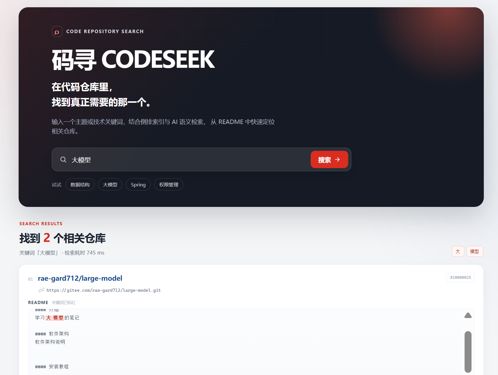

# Code Repository Search Engine

A repository search engine built on Gitee repository READMEs. It combines:

- Jieba tokenization and an inverted index for term-frequency recall;
- `text2vec-base-chinese` and FAISS for semantic recall;
- intersection of both ID lists, returned in semantic-result order.

## Features

- Sync Gitee user repositories, falling back to organization repositories;
- Fetch repositories page by page, filter private repositories, and read READMEs;
- Store repositories in MySQL;
- Build a Jieba `SEARCH`-mode inverted index and filter Chinese/English stopwords after tokenization;
- Hybrid search: inverted index + AI semantic recall;
- `GET /search` endpoint returning complete repository records;
- Console and rolling-file runtime logs for HTTP requests and hybrid-search timing;
- A frontend service on port 3000 with backend proxy, Jieba tokenization, red README highlighting, and 10 results per page;
- A static HTML/CSS UI prototype with repository cards, pagination, and responsive layout;
- Product requirements, backend documentation, and Python vector-service documentation.

## Architecture

```text
                         ┌──────────────────────────┐
                         │     Frontend service     │
                         │     127.0.0.1:3000       │
                         └────────────┬─────────────┘
                                      │ GET /search
                                      ▼
┌─────────────────────────────────────────────────────────────┐
│                    Spring Boot 3.3.3 / Java 17              │
│                                                             │
│  SearchController                                           │
│        │                                                    │
│        ▼                                                    │
│  RepositoryIndexService.search                              │
│        ├── Jieba → inverted index → IDs by term frequency    │
│        └── Python semantic service → IDs by similarity      │
│                         │                                   │
│                         ▼                                   │
│             intersection, returned in semantic order        │
│                         │                                   │
│                         ▼                                   │
│              RepositoryMapper.selectByIdsInOrder            │
│                         │                                   │
│                         ▼                                   │
│                      MySQL repository                       │
└──────────────────────────┬──────────────────────────────────┘
                           │ HTTP
                           ▼
┌─────────────────────────────────────────────────────────────┐
│              Python 3.14 semantic service (8080)             │
│  text2vec-base-chinese → 768-d vectors → FAISS IndexFlatIP   │
└─────────────────────────────────────────────────────────────┘
```

## Project Layout

```text
code-repository-search-engine/
├── backend/                  Spring Boot service, index, semantic client
├── python/                   text2vec vector build and semantic service
├── prd/                      product requirements document
├── frontend/                 runnable search frontend (port 3000)
├── ui/                       static HTML/CSS prototype
├── README.md                 Chinese README
└── README.en.md
```

## Requirements

| Component | Version / Notes |
|---|---|
| JDK | 17 |
| Maven | 3.8.1 (wrapper included) |
| MySQL | 8.x, database `search_engine` |
| Python | 3.14.0, `C:\JAVA\Python314\python.exe` on this machine |
| Node.js | 24.x, for the frontend service |
| npm | 11.x, installs `@node-rs/jieba` |
| Model | local `text2vec-base-chinese` |
| Vector index | FAISS `IndexFlatIP`, numpy cosine fallback supported |

Install Python dependencies:

```powershell
cd python
python -m pip install -r requirements.txt
python -m pip install -r requirements-optional.txt
```

## Database

Run [schema.sql](backend/src/main/resources/db/schema.sql) to create the database and `repository` table.

Set credentials through environment variables:

```powershell
$env:MYSQL_USERNAME = "root"
$env:MYSQL_PASSWORD = "your MySQL root password"
```

To rebuild repository data, call `RepositorySyncService.syncRepositories(username)`.

## Build and Run

### 1. Build Python vectors

```powershell
cd python
$env:PYTHONNOUSERSITE = "1"
$env:MYSQL_PASSWORD = "your MySQL root password"
C:\JAVA\Python314\python.exe build_repository_vectors.py
```

Default output directory:

```text
C:\JAVA\search_engine
```

Generated files:

```text
repository_ids.npy
repository_vectors.npy
repository_faiss.index
repository_index_meta.json
```

### 2. Start the Python semantic service

```powershell
cd python
$env:PYTHONNOUSERSITE = "1"
$env:MYSQL_PASSWORD = "your MySQL root password"
C:\JAVA\Python314\python.exe serve_repository_vectors.py --host 127.0.0.1 --port 8080
```

Endpoints:

```text
GET http://127.0.0.1:8080/health
GET http://127.0.0.1:8080/search?q=large-model&topK=10
```

### 3. Build and start the Java service

```powershell
cd backend
$env:MYSQL_USERNAME = "root"
$env:MYSQL_PASSWORD = "your MySQL root password"

.\mvnw.cmd -DskipTests package
& "$env:JAVA_HOME\bin\java.exe" -jar target\code-repository-search-engine-0.0.1-SNAPSHOT.jar
```

The Java service listens on port `80`. Binding port 80 on Windows may require administrator privileges.

### 4. Start the frontend

Start the Java backend first, then:

```powershell
cd frontend
npm install
npm start
```

Open:

```text
http://localhost:3000
```

The frontend uses the first-version dark Hero design and proxies requests to:

```text
http://localhost/search
```

To use a different backend address:

```powershell
$env:BACKEND_URL = "http://127.0.0.1:8080/search"
npm start
```

## Search API

Request:

```http
GET /search
Content-Type: application/json

{"query":"large-model"}
```

or:

```text
GET /search?query=large-model
```

Response:

```json
[
  {
    "id": 10000025,
    "fullName": "rae-gard712/large-model",
    "htmlUrl": "https://gitee.com/rae-gard712/large-model.git",
    "readme": "# largeModel\n...",
    "repositoryId": 50953942
  }
]
```

Behavior:

- returns at most 1000 repositories;
- intersects inverted-index IDs and semantic IDs;
- returns results in semantic-result order;
- returns `[]` for an empty query or no intersection;
- falls back to inverted-index results when the Python semantic service is unavailable;
- returns the complete README so the frontend can highlight keywords anywhere in the text.

## Configuration

```yaml
server:
  port: 80

repository:
  index:
    path: ${REPOSITORY_INDEX_PATH:./data/repository-index.bin}
  semantic-search:
    base-url: ${SEMANTIC_SEARCH_BASE_URL:http://127.0.0.1:8080}

logging:
  file:
    path: ${LOG_PATH:./logs}
```

The semantic service address can be overridden with:

```powershell
$env:SEMANTIC_SEARCH_BASE_URL = "http://127.0.0.1:8080"
```

## Runtime Logs

Backend logs use Logback with console and rolling-file output:

```text
backend/logs/backend.log
```

Rolling policy:

- maximum 50MB per file;
- daily and size-based rolling;
- 30-day history;
- 2GB total cap;
- compressed `.log.gz` history.

Override the log directory:

```powershell
$env:LOG_PATH = "C:\JAVA\logs\code-repository-search-engine"
```

Logged information includes HTTP method/path/query/status/elapsed time/client IP, search candidate counts, semantic-call timing and fallback warnings, and index load/rebuild events.

## Frontend

The [frontend](frontend/README.md) service runs on port 3000 and includes:

- dark gradient Hero, search box, and suggested keywords;
- result count and Jieba token chips;
- repository cards with name, URL, and README;
- red highlighting for README matches, auto-scrolled to the first match;
- fixed page size of 10; 51 results produce 6 pages, with 1 item on the last page;
- responsive single-column mobile layout.



### npm Cache

`npm install` uses:

```text
%LOCALAPPDATA%\npm-cache
```

On this machine:

```text
C:\Users\27271\AppData\Local\npm-cache
```

`C:\JAVA\npm-cache` was only a temporary cache used during installation. It is safe to delete:

```powershell
Remove-Item "C:\JAVA\npm-cache" -Recurse -Force
```

Deleting the cache does not affect `frontend/node_modules`.

## Stopwords

Chinese and English stopwords are read from:

```text
C:\JAVA\search_engine\stopwords.txt
```

The path can be overridden with `-Dstopwords.path=...` or `STOPWORDS_PATH`. After editing the file, restart the service and rebuild the inverted index.

## UI Prototype

Open `ui/index.html` directly in a browser. See [ui/README.md](ui/README.md).

## Tests

```powershell
cd backend
$env:MYSQL_USERNAME = "root"
$env:MYSQL_PASSWORD = "your MySQL root password"
.\mvnw.cmd test
```

If the environment restricts JVM self-attachment:

```powershell
.\mvnw.cmd test "-DargLine=-Djdk.attach.allowAttachSelf=true"
```

Database tests use real MySQL and roll back with `@Transactional`; live Gitee tests require network access.

## Documentation

- [Product Requirements (Chinese)](prd/代码仓库搜索引擎-PRD-v1.0.md)
- [Backend README](backend/README.md)
- [Python semantic service](python/README.md)
- [Frontend README](frontend/README.md)
- [UI prototype](ui/README.md)

## Notes

- Keep `MYSQL_PASSWORD` and `GITEE_ACCESS_TOKEN` in environment variables.
- `.idea/` is ignored to avoid committing local credentials.
- Java uses port 80, the Python semantic service uses port 8080, and the frontend uses port 3000.
- Runtime indexes, logs, and vector artifacts are not committed.
- Rebuild the inverted index after changing stopwords.

## License

[MIT](LICENSE)
