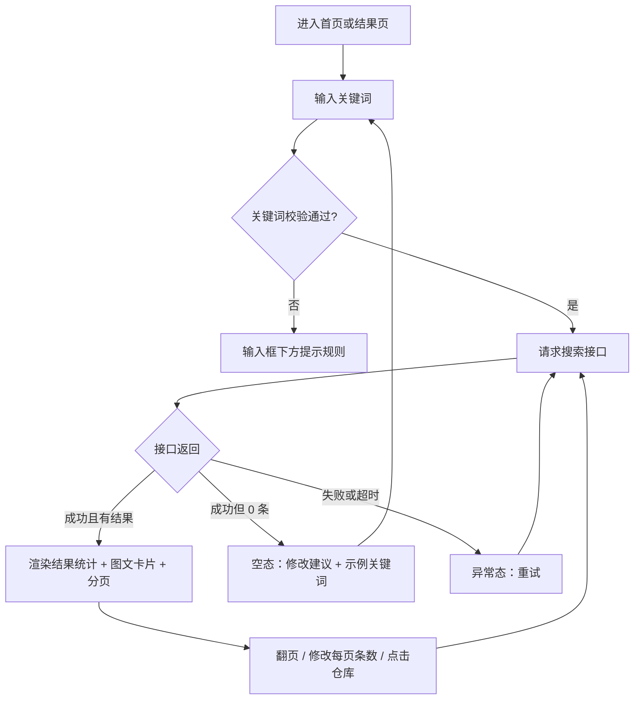

# 代码仓库搜索引擎 PRD

> 用关键词找到仓库，用图文卡片看清仓库，用稳定分页浏览更多可能。

| 项目 | 内容 |
| --- | --- |
| 文档名称 | 代码仓库搜索引擎产品需求文档（PRD） |
| 文档版本 | V1.0 |
| 文档状态 | 评审稿 |
| 产品负责人 | 产品经理 |
| 研发 / 设计 / 测试 | 待定 |
| 创建日期 | 2026-11-02 |
| 最后更新 | 2026-11-02 |
| 适用范围 | Web 端 MVP（桌面端优先，兼容移动端） |
| 需求来源 | 业务规划 / 用户调研 / 竞品分析 |

## 修订记录

| 版本 | 日期 | 修改内容 | 作者 |
| --- | --- | --- | --- |
| V1.0 | 2026-11-02 | 初稿：定义关键词搜索、图文结果卡片、分页浏览及配套体验 | 产品 |

---

## 1. 文档说明

### 1.1 编写目的

本文档用于统一产品、设计、研发、测试和运营对「代码仓库搜索引擎」MVP 的理解，明确：

- 产品要解决什么问题、服务哪些用户；
- 首期做什么、不做什么；
- 关键词搜索、图文结果卡片、分页浏览的详细规则；
- 可被研发实现、被测试验收的功能边界；
- 上线后的衡量指标与运营方式。

本文档是 MVP 的需求基线。未列入本期范围的能力，不纳入本期验收。

### 1.2 名词解释

| 名词 | 说明 |
| --- | --- |
| 仓库 | 一个公开的代码项目，包含名称、简介、语言、Star、Fork、更新时间等元数据 |
| 仓库全名 | `owner/repo-name` 形式，例如 `open-euler/security-center` |
| 图文样式 | 搜索结果以「图片 + 文本信息」的卡片形式呈现，而非纯文字列表 |
| 关键词搜索 | 用户输入一个或多个词，系统在仓库名称、简介、主题、语言、README 等字段中检索 |
| 综合排序 | 综合文本相关性、名称精确匹配、仓库质量与活跃度的默认排序方式 |
| 分页 | 将搜索结果按固定条数切分，通过页码、上一页/下一页等控件浏览 |
| P0 / P1 / P2 | P0 为 MVP 必须交付；P1 为首期后优先增强；P2 为中长期规划 |
| 有效搜索会话 | 一次搜索会话中，用户至少点击了一个仓库结果 |

### 1.3 优先级定义

| 优先级 | 定义 | 本期处理 |
| --- | --- | --- |
| P0 | 没有它，核心用户任务无法完成 | 必须上线 |
| P1 | 明显提升效率和结果质量 | 排期增强，不作为 MVP 验收阻塞项 |
| P2 | 面向未来场景的探索能力 | 仅做方案预留 |

---

## 2. 产品背景与机会

### 2.1 背景

开发者在学习开源项目、进行技术选型或寻找可复用组件时，通常先通过关键词搜索代码仓库。Gitee、GitHub 等平台已经证明「仓库搜索」是开发者高频入口，但常见体验仍有优化空间：

- **结果信息密度低**：纯文字列表需要逐条阅读名称和简介，难以快速判断项目类型、技术栈和活跃度。
- **视觉识别缺失**：仓库缺少稳定、可理解的封面或图标，用户只能靠文字建立第一印象。
- **关键词理解粗糙**：中英文混合、技术同义词、缩写和长关键词容易导致结果偏离预期。
- **分页体验割裂**：翻页后丢失查询条件、回到顶部、页码越界、加载闪烁等问题频繁出现。
- **结果质量不可度量**：缺少零结果率、点击率、翻页率等指标，搜索质量难以持续优化。

### 2.2 产品定位

面向中文开发者的**代码仓库发现与检索工具**。首期聚焦「仓库级关键词搜索」，通过清晰的图文卡片和稳定的分页浏览，帮助用户在 30 秒内完成从「有一个模糊需求」到「找到若干可进一步了解的仓库」的初筛。

产品不替代代码级搜索，也不替代仓库详情页；它负责把「值得点开看的仓库」高效地呈现出来。

### 2.3 用户价值主张

1. **搜得到**：输入自然关键词，能召回名称、简介、主题、语言和 README 中的相关内容。
2. **看得清**：图文卡片同时呈现封面、简介、技术栈和活跃度，降低逐条阅读成本。
3. **翻得顺**：分页状态、URL、滚动位置和加载反馈稳定，浏览多页结果不迷失。
4. **可判断**：用 Star、Fork、更新时间、语言、归档状态等信号辅助初筛。

### 2.4 产品目标

| 目标 | 说明 | 对应需求 |
| --- | --- | --- |
| G1 建立可靠的关键词检索 | 支持中英文关键词，覆盖核心仓库字段，返回相关性合理的结果 | FR-01 ~ FR-08 |
| G2 提升结果识别效率 | 搜索结果默认使用图文卡片，图片缺失时有稳定降级 | FR-09 ~ FR-16 |
| G3 支持多结果连续浏览 | 默认每页 20 条，支持页码、每页条数、页码跳转和 URL 恢复 | FR-17 ~ FR-24 |
| G4 建立质量度量闭环 | 记录搜索、曝光、点击、翻页、异常等行为 | FR-25 ~ FR-26 |

### 2.5 成功指标（首期目标，灰度后校准）

| 指标 | 定义 | 首期目标 |
| --- | --- | --- |
| 有效搜索会话率 | 有至少一次仓库点击的搜索会话 / 全部搜索会话 | ≥ 65% |
| 搜索结果点击率 CTR@20 | 前 20 条结果的点击次数 / 前 20 条结果曝光次数 | ≥ 25% |
| 零结果率 | 结果数为 0 的搜索次数 / 全部搜索次数 | ≤ 10% |
| 翻页使用率 | 发生第 2 页及以后浏览的会话 / 有结果的搜索会话 | 观察指标，首期不设硬目标 |
| 搜索接口 P95 延迟 | 服务端搜索接口 95 分位耗时 | ≤ 500 ms |
| 结果页 LCP | 4G 网络下结果首屏最大内容绘制 | ≤ 2.5 s |
| 图片降级率 | 使用占位图/备用图的卡片数 / 图片卡片曝光数 | ≤ 3% |
| 搜索可用性 | 搜索接口月度成功响应率 | ≥ 99.9% |

> 指标口径、埋点事件和看板要求见第 9 章。

---

## 3. 用户与使用场景

### 3.1 目标用户

| 用户角色 | 典型画像 | 核心诉求 | 当前痛点 |
| --- | --- | --- | --- |
| 技术选型者 | 3~10 年经验的后端/前端/全栈工程师，负责方案调研 | 快速比较同类框架、组件和脚手架 | 结果太泛，缺少质量与活跃度信号，需反复点开详情 |
| 开源学习者 | 学生、初中级开发者、转岗学习者 | 找到适合入门的完整项目 | 不知道搜什么、结果看不懂、缺少直观的第一印象 |
| 独立开发者 / 创业者 | 需要快速找到可复用轮子 | 按功能、技术栈精准找到可用仓库 | 关键词表达不准，翻几页仍找不到合适项目 |
| 技术内容运营 | 社区运营、技术编辑 | 发现优质项目、制作专题 | 缺少可筛选、可复用的结果集合（本期仅基础能力） |

### 3.2 核心场景

| 场景编号 | 场景 | 用户任务 | 示例查询 | 期望结果 |
| --- | --- | --- | --- | --- |
| S1 | 技术选型 | 对比同类开源方案 | `Java 权限管理 框架` | 首页出现多个相关仓库，能直接看到语言、Star、更新时间和简介 |
| S2 | 精确查找 | 找回已知仓库 | `vue-element-admin` | 名称精确匹配的仓库排在首位，图文卡片可直接识别 |
| S3 | 探索发现 | 浏览某类项目 | `低代码 平台` | 结果数量明确，可翻页查看更多，翻页后条件不丢失 |
| S4 | 学习入门 | 找适合学习的完整项目 | `Spring Boot 入门项目` | 简介和主题能说明项目用途，归档/低活跃项目有提示 |
| S5 | 结果修正 | 搜索结果不理想 | `微信小程序 富文本 编辑器` → 减少关键词 | 空态或低相关时给出可执行的修改建议 |

### 3.3 用户旅程（主路径）

1. 用户进入搜索首页，看到搜索框和示例关键词。
2. 输入关键词并提交，进入结果页。
3. 首屏加载图文卡片，展示结果总数和分页信息。
4. 用户浏览卡片，通过封面、简介、语言、Star、更新时间做初筛。
5. 用户点击仓库卡片进入详情页；或翻到下一页继续浏览。
6. 用户修改关键词、每页条数或排序条件，结果与页码同步更新。

---

## 4. 产品范围

### 4.1 MVP 范围（P0）

| 模块 | 能力 |
| --- | --- |
| 搜索入口 | 首页搜索框、结果页搜索框、关键词校验、回车/按钮触发 |
| 关键词检索 | 仓库名称、全名、简介、主题、语言、README、所有者等字段检索；中英文基础处理；多关键词 AND 语义 |
| 结果展示 | 结果总数、图文卡片列表、关键词高亮、基础仓库元数据、归档标识 |
| 图片能力 | 仓库封面/所有者头像展示、懒加载、骨架屏、加载失败降级为占位图 |
| 分页 | 默认 20 条/页，支持 10/20/50 条切换、页码、上一页/下一页、页码跳转、边界处理 |
| 状态与恢复 | 加载、成功、空结果、异常、图片降级；查询条件与页码写入 URL，支持刷新/分享/前进后退 |
| 响应式 | 桌面端优先，适配 375px 及以上移动端 |
| 可访问性 | 键盘可操作、图片替代文本、焦点可见、语义化结构 |
| 数据与埋点 | 搜索、曝光、点击、翻页、异常等核心事件 |

### 4.2 P1 范围（首期后增强）

- 排序扩展：最多 Star、最近更新、最多 Fork。
- 结果筛选：语言、Star 区间、更新时间、许可证；筛选条件与分页联动。
- 搜索建议：历史搜索（本地）、热门搜索、仓库名与主题补全。
- 匹配片段：当关键词只命中 README 时，在卡片中展示上下文摘要。
- 图片增强：从 README 首图提取仓库预览图，提升图文相关性。
- AI 摘要：为卡片生成一句话项目摘要，明确标注「AI 生成」。
- AI 查询理解：同义词扩展、中英文术语映射、拼写纠错，并在界面提示已扩展的查询。
- SEO 基础能力：搜索落地页可收录，结果页 canonical 策略。

### 4.3 P2 范围（探索）

- 混合语义检索：关键词召回 + 向量召回 + 重排，支持自然语言描述需求。
- 对话式找仓库：多轮澄清技术栈、许可证、部署方式等条件。
- 个性化推荐：基于浏览、收藏和技术栈的仓库推荐。
- 仓库对比、收藏夹、订阅更新、开发者主页。

### 4.4 本期不做

- 代码内容级搜索（函数、变量、文件内容定位）。
- 仓库详情页、Issue、Pull Request、代码浏览。
- 用户注册登录、收藏、评论、下载、克隆。
- 私有仓库、企业仓库、仓库上传与管理后台。
- 无限滚动、瀑布流、列表/宫格切换。
- 多语言界面（首期仅简体中文）。
- 付费推广位、竞价排名。

### 4.5 前置假设与依赖

1. 拥有合法授权的公开仓库数据源，字段覆盖第 7 章要求；数据使用符合相关法律法规和平台协议。
2. 仓库详情页已存在，或结果卡片可跳转到外部合法地址；本期不建设详情页。
3. 仓库封面或所有者头像可通过数据源获得；图片使用已获得授权或属于平台可展示资源。
4. 搜索服务具备中文分词、英文归一化和基础相关性排序能力。
5. MVP 按 100 万仓库、峰值 200 QPS 设计，后续可水平扩展。

---

## 5. 产品结构与核心流程

### 5.1 页面结构

| 页面 | 路由 | 说明 |
| --- | --- | --- |
| 搜索首页 | `/` | 品牌区、搜索框、示例关键词、产品简介 |
| 搜索结果页 | `/search?q={关键词}&page={页码}&per_page={每页条数}` | 搜索框、结果统计、排序区（P1）、图文列表、分页 |
| 仓库详情页 | `/repos/{owner}/{repo}` 或外部地址 | 本期不建设，作为卡片跳转目标 |
| 异常页 | `/error` 或结果页内异常态 | 网络/服务异常提示与重试 |

### 5.2 信息架构

```text
代码仓库搜索引擎
├── 搜索首页
│   ├── 搜索框
│   ├── 示例关键词
│   └── 产品说明
├── 搜索结果页
│   ├── 顶部搜索区
│   ├── 结果统计与排序（排序 P1）
│   ├── 结果列表
│   │   └── 图文仓库卡片 × N
│   ├── 分页器
│   └── 空态 / 异常态 / 加载态
└── 仓库详情页（跳转，本期不建设）
```

### 5.3 核心流程图



### 5.4 结果页状态机

| 状态 | 触发条件 | 页面表现 | 用户可执行操作 |
| --- | --- | --- | --- |
| 初始态 | 首次进入，未提交搜索 | 首页展示搜索框与示例 | 输入、提交 |
| 加载态 | 请求进行中 | 保留搜索区，结果区显示 8 个卡片骨架 | 可修改关键词，旧请求取消 |
| 成功态 | 请求成功且 `total > 0` | 结果统计、卡片列表、分页器 | 翻页、点击仓库、修改关键词 |
| 空结果态 | 请求成功且 `total = 0` | 空态插画、提示、建议、示例关键词 | 修改关键词、清空筛选、返回首页 |
| 异常态 | 网络错误、超时、5xx、限流 | 错误说明、请求编号、重试按钮 | 重试、返回首页 |
| 页码越界态 | `page > total_pages` 且 `total > 0` | 自动跳转最后一页并轻提示 | 继续浏览、修改关键词 |
| 部分降级态 | 图片加载失败，搜索结果成功 | 图片替换为占位图，文本正常 | 正常浏览 |

---

## 6. 功能需求

### 6.1 搜索入口与关键词处理

#### FR-01 搜索框（P0）

**需求描述**

首页和结果页均提供搜索框，支持用户输入关键词并提交检索。

**详细规则**

- 首页搜索框默认聚焦，占位文案：`搜索仓库名称、简介或技术栈，如：权限管理`。
- 结果页搜索框回填当前查询词，修改后再次提交视为一次新搜索。
- 搜索框支持清空按钮；有内容时显示，点击后清空并重新聚焦。
- 提交方式：按 `Enter` 或点击「搜索」按钮。
- 请求进行中，搜索按钮显示加载状态并防止重复提交；用户发起新搜索时取消旧请求。
- 搜索框最大宽度 720px，移动端占满可用宽度。

**验收要点**

- 空关键词点击搜索不发起请求，输入框显示「请输入关键词」。
- 输入内容后按 Enter 能发起搜索，按钮与 Enter 行为一致。
- 结果页刷新后，搜索框仍显示 URL 中的关键词。

#### FR-02 关键词校验与归一化（P0）

| 规则 | 说明 |
| --- | --- |
| 长度 | 去除首尾空白后，1~100 个字符（按 Unicode 字符计） |
| 空白 | 连续空格、全角空格归一为一个半角空格 |
| 大小写 | 英文检索不区分大小写，展示保留原文 |
| 特殊字符 | 作为普通文本处理，不解释为查询语法；服务端转义，防止注入 |
| 空值 | 纯空白、仅控制字符视为空，不发起请求 |
| 超长 | 超过 100 字符时阻止提交，提示「关键词最多 100 个字符」 |
| 敏感词 | 命中平台敏感词库时不返回结果，展示合规提示；具体词库由运营维护 |

**说明**

MVP 不支持 `AND`、`OR`、`language:Java` 等高级查询语法。用户输入的内容一律按普通关键词处理；高级语法列入 P2。

#### FR-03 搜索触发与请求策略（P0）

- 用户提交后，页面不整页刷新，使用前端路由更新 URL 并请求接口。
- 相同关键词、相同页码、相同每页条数的重复提交，在 1 秒内复用上一次请求结果，不重复请求。
- 用户快速连续提交不同关键词时，只渲染最后一次请求的结果；旧请求通过 `AbortController` 取消。
- 请求超时时间为 8 秒；超时进入异常态。
- 搜索请求需携带 `request_id`，用于问题定位。

#### FR-04 搜索范围与字段权重（P0）

仅检索**公开、正常状态、非 Fork**的仓库；排除私有、已删除、已屏蔽、空仓库。已归档仓库可被检索，但需降权并展示「已归档」标识。

| 字段 | 建议权重 | 说明 |
| --- | --- | --- |
| 仓库全名 `owner/repo` | 5 | 精确匹配优先级最高 |
| 仓库名 `repo` | 5 | 支持中英文、连字符、下划线 |
| 主题 / 标签 `topics` | 4 | 如 `spring-boot`、`权限管理` |
| 简介 `description` | 3 | 主要语义来源 |
| 编程语言 `language` | 2 | 输入 `Java` 可召回 Java 仓库 |
| README 正文 | 1 | 截断索引，建议前 64KB；仅作为补充召回 |
| 所有者 `owner` | 1 | 支持按组织/作者查找 |

**检索语义**

- 多个关键词之间默认 **AND**：所有关键词都必须在至少一个字段中命中，才进入结果集。
- 单个关键词可命中多个字段，字段权重累加。
- 英文按小写归一；中文使用分词召回；仓库名和全名额外保留精确匹配字段。
- 结果按 `repo_id` 去重，同一仓库只出现一次。
- 默认不展示 Fork 仓库，避免重复项目干扰；P1 提供「包含 Fork」开关。

**排序原则（综合排序）**

1. 全名或仓库名精确匹配优先。
2. 字段相关性：名称 > 主题 > 简介 > 语言 > README > 所有者。
3. 质量与活跃度加成：Star、Fork、近期更新、完整简介、有效封面。
4. 降权项：已归档、长期未更新、疑似垃圾/重复仓库。
5. 不展示无权限、已删除或违规仓库。

> 具体打分公式由搜索服务实现并通过标注集调优，产品验收以「Top 10 结果相关性抽检」为准。

#### FR-05 搜索结果统计（P0）

- 结果区顶部展示：`找到 1,248 个仓库`。
- 总数 ≤ 10,000 时展示精确值；超过 10,000 时展示 `10,000+`，避免深分页计数开销。
- 总数使用千分位；数字需带 `aria-label`，例如「共一千二百四十八个仓库」。
- 结果数在请求成功后更新；加载中不展示旧结果数，避免误导。

#### FR-06 示例关键词与搜索引导（P0）

- 首页搜索框下方展示 4~6 个示例关键词，例如：`权限管理`、`低代码`、`Spring Boot`、`数据可视化`、`微信小程序`、`机器学习`。
- 点击示例词直接发起搜索。
- 示例词由运营配置，需经过内容审核，不得出现侵权、违规或诱导性词汇。
- 空结果页复用示例词组件，文案改为「换个关键词试试」。

#### FR-07 搜索历史（P1）

- 仅在用户本地浏览器保存最近 10 条搜索记录，不同步到服务端。
- 支持单条删除和全部清空。
- 无痕模式或用户关闭本地存储时不展示。
- 不记录敏感词和违规查询。

#### FR-08 搜索建议（P1）

- 输入时展示仓库名、主题、热门搜索的补全建议，最多 8 条。
- 键盘上下键选择，Enter 确认，Esc 关闭。
- 建议结果需过滤违规词，并避免展示私有仓库名称。
- 建议请求防抖 250ms，不影响主搜索请求。

---

### 6.2 搜索结果：图文卡片

#### FR-09 结果列表结构（P0）

结果区采用**单列图文卡片列表**，每页展示多个仓库。每张卡片由左侧图片和右侧文本信息组成。

**桌面端布局**

```text
┌──────────────────────────────────────────────────────────────────────┐
│  找到 1,248 个仓库                              综合排序（P1 可展开） │
├──────────────────────────────────────────────────────────────────────┤
│  ┌────────┐  open-euler / security-center              [已归档]      │
│  │        │  基于 Spring Boot 的权限管理与 RBAC 框架，支持多租户…   │
│  │  封面  │  [权限管理] [RBAC] [Spring Boot] +2                   │
│  │  4:3   │  ★ 1.2k   ⑂ 230   ● Java   Apache-2.0   2 天前更新     │
│  └────────┘                                                          │
├──────────────────────────────────────────────────────────────────────┤
│  ┌────────┐  ...                                                     │
│  │  图片  │  ...                                                     │
│  └────────┘                                                          │
├──────────────────────────────────────────────────────────────────────┤
│  共 1,248 个结果    ‹ 上一页  1  2  3 … 63  下一页 ›   20 条/页     │
└──────────────────────────────────────────────────────────────────────┘
```

**布局规则**

- 结果区最大宽度 1120px，居中；桌面端左右留白不小于 24px。
- 单列卡片，卡片间距 12px；卡片内边距 16px。
- 图片位于左侧，固定 4:3 比例，桌面端 112×84px；文本区自适应剩余宽度。
- 每页默认 20 张卡片；首屏至少完整展示 3 张，便于用户判断结果质量。
- 卡片整体可点击，点击区域覆盖整张卡片；不设置嵌套链接，避免键盘焦点冲突。
- 卡片高度随内容自适应，但同一页内图片和主要信息基线保持一致。

#### FR-10 图片展示规则（P0）

**图片源优先级**

| 优先级 | 来源 | 说明 |
| --- | --- | --- |
| 1 | 仓库封面 / 项目标识 | 仓库 owner 主动设置或数据源提供的项目图片 |
| 2 | 所有者头像 | 仓库无封面时使用 owner 头像，保证卡片始终有图 |
| 3 | 系统占位图 | 前两者缺失、加载失败或被拦截时使用 |

> P1 增加「README 首图」来源：仅提取合法、可访问、尺寸足够的图片，且需经过安全与内容审核。

**图片规格**

| 项目 | 要求 |
| --- | --- |
| 展示尺寸 | 桌面端 112×84px；移动端 88×66px；固定 4:3 |
| 清晰度 | 支持 2x 图，源图建议不小于 224×168px |
| 格式 | 优先 WebP，兼容 JPEG/PNG；禁止直接渲染 SVG 和用户上传的 HTML |
| 文件大小 | 单图建议 ≤ 150KB；通过图片代理压缩、裁剪 |
| 圆角 | 8px |
| 背景 | `#F2F3F5`，图片加载前显示 |
| 边框 | 1px `#E5E6EB`，避免浅色图片与背景融合 |
| 裁剪 | `object-fit: cover`，保持比例，不拉伸 |
| 懒加载 | 首屏前 4 张立即加载，其余 `loading="lazy"`；提前预留宽高，避免布局抖动 |
| 替代文本 | `alt="{owner}/{repo} 的仓库封面"`；占位图 `alt=""`，避免重复朗读 |
| 缓存 | CDN 缓存不少于 7 天；仓库封面更新后主动失效 |
| 安全 | 图片经服务端代理，校验 MIME、大小、来源；剥离 EXIF；拦截非法域名和 SSRF |

**加载与降级**

1. 图片区域先展示骨架/纯色底，保持 4:3 占位。
2. 图片加载成功后淡入，避免闪烁。
3. 加载失败、403、超时 2 秒、格式非法时，切换为系统占位图。
4. 占位图使用仓库名首字符 + 确定性渐变色（同一仓库颜色稳定），或使用语言图标。
5. 占位图不得出现破图图标、空白区域或 alt 文本溢出。
6. 图片降级不阻塞文本展示，不触发整页错误态。
7. 记录 `image_fallback` 事件，便于监控图片服务质量。

**内容合规**

- 仅展示平台有权使用的图片；第三方图片需有明确授权或采用平台默认素材。
- 禁止展示色情、暴力、赌博、侵权、二维码导流等违规图片。
- 运营需具备图片下架能力；下架后卡片自动回退到占位图。

#### FR-11 卡片文本信息（P0）

| 信息区 | 展示规则 |
| --- | --- |
| 仓库全名 | `owner / repo`；owner 使用次级文字色，repo 加粗；单行，超长省略，`title` 展示完整名称 |
| 简介 | 最多 2 行，约 120 个字符；超出省略；无简介时展示「暂无简介」，使用弱化色 |
| 主题标签 | 最多展示 3 个，超出显示 `+N`；标签不可点击（避免嵌套交互）；无主题时隐藏 |
| 编程语言 | 颜色圆点 + 语言名；无语言时显示「未标记」 |
| Star 数 | 星形图标 + 格式化数字；`< 1000` 展示原值，`≥ 1000` 展示一位小数 + `k`，如 `1.2k`；悬停展示精确值 |
| Fork 数 | 分叉图标 + 格式化数字；规则同上 |
| 更新时间 | 1 分钟内「刚刚」；1 小时内「x 分钟前」；24 小时内「x 小时前」；30 天内「x 天前」；超过 30 天展示 `YYYY-MM-DD` |
| 许可证 | 有则展示简称，如 `Apache-2.0`；无则不展示 |
| 状态标识 | 已归档展示「已归档」徽标；其他状态本期不展示 |
| 匹配片段 | P1：关键词仅命中 README 时，展示命中上下文，最多 1 行 |
| AI 摘要 | P1：展示一句话摘要，带「AI 生成」标识和反馈入口 |

**排版规范**

- 仓库全名：16px / 600，单行。
- 简介：14px / 400，行高 22px，最多 2 行。
- 标签：12px，浅灰底，圆角 4px。
- 元数据：12px，次级文字色；各项间距 12px。
- 卡片内文本不重叠；窄屏时元数据自动换行，不出现横向滚动。

#### FR-12 关键词高亮（P0）

- 对仓库名、全名、简介中命中的关键词进行高亮，使用 `<mark>` 语义标签。
- 英文不区分大小写；中文按分词结果和原始子串双重匹配，避免漏高亮。
- 单张卡片最多高亮 5 处，避免视觉噪音。
- 高亮内容必须先转义再插入，禁止将用户输入当作 HTML 渲染。
- 高亮样式：浅黄背景 + 深色文字，同时满足对比度要求；不能仅靠颜色传达信息。
- 若关键词只命中 README，而卡片未展示 README 片段，则本期不高亮，P1 通过匹配片段解决。

#### FR-13 卡片交互（P0）

- 鼠标悬停：卡片背景轻微加深、边框加深，显示可点击指针；不使用大幅位移或缩放。
- 键盘聚焦：显示 2px 高对比度焦点环，`Enter` 打开仓库。
- 点击整张卡片进入仓库详情页；默认当前标签页打开，支持 `Ctrl/Cmd + 点击` 新标签页打开。
- 卡片使用 `<a>` 作为主链接，确保右键「在新标签页打开」、复制链接等浏览器原生能力可用。
- 卡片内不放置按钮、链接等嵌套交互元素；标签、统计数字均为纯展示。
- 点击后记录 `repo_card_click` 事件，包含位置、页码、是否带图、图片类型。
- 仓库地址缺失或非法时，卡片置为不可点击态并记录数据异常，不跳转到错误页面。

#### FR-14 结果加载态（P0）

- 首次加载展示 8 个卡片骨架屏，每个骨架包含图片块、标题行、两行简介和元数据行。
- 骨架屏尺寸与真实卡片一致，避免加载完成后布局跳动。
- 加载中保留搜索框和结果统计区域的结构；结果数显示为占位符，不显示旧数据。
- 翻页加载时，仅结果列表区域显示骨架或半透明加载层，分页器保持可见但禁用重复点击。
- 加载超过 300ms 才显示骨架，避免快速请求造成闪烁。
- 加载超过 8 秒进入超时异常态。

#### FR-15 空结果态（P0）

**展示内容**

- 插画/图标。
- 主文案：`未找到与「{关键词}」相关的仓库`。
- 辅助文案：`试试减少关键词、更换同义词，或浏览下面的热门主题。`
- 操作按钮：`修改关键词`、`清空筛选`（有筛选时）。
- 示例关键词 4~6 个。

**规则**

- 空结果不展示分页器。
- 关键词需转义后展示，超长时截断。
- 若因敏感词被拦截，展示合规提示，不展示敏感词本身。
- 空结果页需记录 `search_result_view` 事件，标记 `zero_result=true`。
- 不自动放宽为 OR 查询，避免结果突然泛化；由用户主动修改关键词。

#### FR-16 异常态（P0）

| 异常类型 | 文案 | 操作 |
| --- | --- | --- |
| 网络断开 | 网络连接异常，请检查网络后重试 | 重试 |
| 请求超时 | 搜索超时，请稍后重试 | 重试 |
| 服务异常（5xx） | 搜索服务暂时不可用，请稍后重试 | 重试、返回首页 |
| 请求过于频繁（429） | 操作过于频繁，请稍后再试 | 倒计时后可重试 |
| 参数非法（400） | 搜索条件有误，请修改后重试 | 返回首页 |
| 图片服务异常 | 不影响结果浏览，图片自动降级 | 无 |

- 异常态展示请求编号（后 8 位），便于用户反馈和排查。
- 重试时保留原关键词和页码。
- 连续 3 次失败后，提示用户稍后再试，避免无限重试。

---

### 6.3 搜索结果：分页

#### FR-17 分页基础规则（P0）

| 项目 | 规则 |
| --- | --- |
| 页码起点 | 1 |
| 默认每页条数 | 20 条 |
| 可选每页条数 | 10 / 20 / 50 条 |
| 默认总页数 | `ceil(total / per_page)` |
| 分页器位置 | 结果列表底部；结果较多时，顶部统计区提供「共 N 页」文字 |
| 最小展示 | 每页至少展示 10 个仓库，满足「一页多个仓库」的核心诉求 |
| 最大可浏览结果 | MVP 最多可浏览前 2,000 条；超过时提示缩小范围（P1 支持深分页） |
| 结果为空 | 不展示分页器 |
| 单页结果 | 只有 1 页时隐藏页码，仅保留结果总数与每页条数选择 |

**总数与页数**

- `total_pages = ceil(total / per_page)`。
- 当 `total = 0` 时，`total_pages = 0`，不展示分页。
- 当 `total > 0` 且 `total_pages = 1` 时，不展示页码和上一页/下一页。
- 当结果总数超过 2,000 时，分页器只展示到第 2,000 条对应的页码，并展示提示：
  `结果较多，仅可浏览前 2,000 条，请增加关键词或筛选条件。`

#### FR-18 分页器组成（P0）

分页器从左到右包含：

1. **结果摘要**：`共 1,248 个结果`。
2. **上一页按钮**：第 1 页禁用。
3. **页码列表**：当前页高亮；最多展示 7 个页码位；超过时使用省略号。
4. **下一页按钮**：最后一页禁用。
5. **页码跳转**：输入框 + 「跳转」按钮；仅桌面端展示，移动端隐藏。
6. **每页条数选择**：`10 条/页`、`20 条/页`、`50 条/页`。

**页码省略规则**

- 总页数 ≤ 7：全部展示。
- 总页数 > 7：始终展示第 1 页、最后一页、当前页及前后各 1 页；其余用省略号。
- 示例：当前第 1 页 → `1 2 3 4 5 … 63`；当前第 32 页 → `1 … 31 32 33 … 63`；当前第 63 页 → `1 … 59 60 61 62 63`。

#### FR-19 翻页交互（P0）

- 点击页码、上一页、下一页后，保持当前关键词、每页条数和其他筛选条件不变，仅更新 `page`。
- 翻页时结果区显示加载态，搜索框与结果统计保持可见；分页按钮在请求期间禁用，防止重复请求。
- 请求成功后，页面滚动到结果列表顶部（结果统计区下方），不回到页面绝对顶部。
- 浏览器地址栏同步更新，例如：`/search?q=权限管理&page=2&per_page=20`。
- 更新页面标题：`权限管理 - 第 2 页 - 代码仓库搜索`。
- 使用浏览器前进/后退时，根据 URL 恢复关键词、页码和每页条数；P0 至少保证查询条件与页码正确，滚动位置可依赖浏览器缓存。
- 翻页请求失败时，保留当前页内容和分页器，展示轻量错误提示与重试入口，不清空已加载结果。

#### FR-20 每页条数切换（P0）

- 用户切换每页条数后，重置到第 1 页，避免页码错位。
- 新条数写入 URL 的 `per_page` 参数。
- 切换后重新请求并更新结果总数、总页数。
- 每页条数仅允许 10、20、50；非法值回退到 20。
- 移动端保留每页条数选择，但使用紧凑样式。

#### FR-21 页码跳转（P0）

- 仅桌面端展示跳转输入框。
- 输入必须为正整数；输入非数字、0、负数时提示「请输入有效页码」。
- 输入超过总页数时，自动跳转到最后一页，并轻提示「已跳转到最后一页」。
- 输入框支持 Enter 提交。
- 跳转后清空输入框，保持分页器整洁。

#### FR-22 页码边界与数据变化（P0）

- `page < 1` 或非数字：规范化为第 1 页。
- `page > total_pages` 且 `total > 0`：自动跳转到最后一页，并更新 URL；展示轻提示。
- `total = 0`：忽略页码，展示空结果态。
- 翻页过程中结果总数减少导致当前页超出范围：请求返回后自动回退到最后一页，保留关键词并提示。
- 结果总数增加导致总页数变化：正常更新分页器，不强制跳转。
- 页码超出 2,000 条上限：跳转到上限所在页，并展示上限提示。

#### FR-23 分页加载与并发控制（P0）

- 任意时刻只允许一个分页请求处于活动状态。
- 用户连续点击多个页码时，以最后一次点击为准，取消之前请求。
- 只有最新请求的响应可以更新列表、总数和分页器，避免旧响应覆盖新页面。
- 请求期间分页器显示加载状态，当前页保持高亮。
- 请求失败时恢复分页器可操作状态，并保留原页码。

#### FR-24 分页可访问性与移动端（P0）

- 分页器使用 `<nav aria-label="搜索结果分页">`。
- 当前页使用 `aria-current="page"`。
- 上一页/下一页按钮具备可读的 `aria-label`，禁用时使用 `disabled`。
- 键盘 `Tab` 可依次聚焦分页控件，`Enter/Space` 可触发。
- 翻页完成后，通过 `aria-live="polite"` 播报「已加载第 2 页，共 63 页」。
- 移动端（< 768px）分页器简化为：`上一页`、`第 2 / 63 页`、`下一页`，并提供每页条数选择；不展示完整页码列表和跳转框。
- 移动端触控目标不小于 44×44px。

---

### 6.4 结果页其他规则

#### FR-25 搜索行为埋点（P0）

| 事件名 | 触发时机 | 核心属性 |
| --- | --- | --- |
| `search_submit` | 用户提交搜索 | `query`、`page`、`per_page`、`source`（首页/结果页/示例词）、`request_id` |
| `search_result_view` | 结果成功渲染 | `query`、`total`、`result_count`、`zero_result`、`latency_ms`、`page` |
| `repo_card_click` | 点击仓库卡片 | `query`、`repo_id`、`position`、`page`、`has_image`、`image_type` |
| `page_change` | 翻页或切换每页条数 | `from_page`、`to_page`、`per_page`、`method`（页码/上一页/下一页/跳转/条数） |
| `search_error` | 请求失败 | `query`、`error_code`、`http_status`、`request_id` |
| `image_fallback` | 图片降级 | `repo_id`、`reason`（404/超时/格式/违规）、`page` |
| `ai_summary_view` | P1：AI 摘要曝光 | `repo_id`、`has_summary`、`latency_ms` |

**埋点要求**

- 事件必须携带 `request_id`，便于串联一次搜索的请求、结果和点击。
- 不上报完整 IP、设备号等个人敏感信息；查询词按隐私政策处理。
- 埋点失败不得影响主流程。
- 曝光去重：同一会话内同一卡片同一位置只计一次曝光（翻页后重新计）。

#### FR-26 页面标题与分享（P0）

- 首页标题：`代码仓库搜索 - 发现优质开源项目`。
- 结果页标题：`{关键词} - 代码仓库搜索`；翻页后追加 `第 N 页`。
- 结果页 URL 可直接分享；他人打开后恢复相同关键词、页码和每页条数。
- 无结果或异常时，标题仍需包含关键词，便于用户识别标签页。
- 分享卡片（P1）：展示关键词、结果数和品牌信息。

---

### 6.5 排序与筛选（P1）

| 需求编号 | 能力 | 规则 |
| --- | --- | --- |
| FR-27 | 排序 | 综合排序（默认）、最多 Star、最近更新、最多 Fork；切换后重置到第 1 页并写入 URL |
| FR-28 | 语言筛选 | 从结果聚合中提取 Top 10 语言；支持多选；无结果的语言不展示 |
| FR-29 | Star 区间 | 不限、10+、100+、1,000+、10,000+ |
| FR-30 | 更新时间 | 不限、最近一周、最近一月、最近一年 |
| FR-31 | 筛选状态 | 展示已选条件标签，支持单条移除和全部清空；筛选变化重置页码 |
| FR-32 | 无筛选结果 | 展示「当前筛选条件下无结果」，提供「清空筛选」按钮 |

> P1 功能上线前需补充独立的交互稿和验收用例；不得影响 P0 搜索与分页链路的稳定性。

---

### 6.6 AI 增强能力（P1 / P2）

本项目定位为「基于 AI 工具的代码仓库搜索引擎」。AI 能力应服务于搜索质量和理解效率，而不是替代基础检索。

| 能力 | 优先级 | 说明 | 产品约束 |
| --- | --- | --- | --- |
| AI 查询理解 | P1 | 识别中英文技术同义词、缩写、拼写错误，生成扩展查询；界面可提示「已为你扩展：权限管理 / RBAC / 访问控制」 | 扩展必须可关闭；不得改变用户原始关键词的展示；无结果时不得强行编造结果 |
| AI 卡片摘要 | P1 | 基于 README 和元数据生成一句话项目摘要，帮助快速判断 | 必须标注「AI 生成」；不得编造 Star、许可证、更新时间等事实；提供「不准确」反馈 |
| 混合语义检索 | P2 | 关键词召回 + 向量召回 + 重排，支持自然语言需求描述 | 需离线评估相关性；保留纯关键词降级链路 |
| 对话式找仓库 | P2 | 多轮澄清技术栈、许可证、部署方式等 | 需明确告知用户正在与 AI 交互；结果仍需可回溯到仓库来源 |

**通用降级要求**

- AI 服务超时或失败时，自动降级为纯关键词检索，不阻塞结果展示。
- AI 摘要不得影响首屏 LCP；可先展示卡片文本，再异步加载摘要。
- AI 生成内容需经过敏感内容过滤；用户可反馈问题。
- 所有 AI 结果需保留来源仓库链接，禁止生成不存在的仓库。

---

## 7. 数据与接口要求

### 7.1 索引字段

| 字段 | 类型 | 是否检索 | 说明 |
| --- | --- | --- | --- |
| `repo_id` | string | 否 | 仓库唯一标识，用于去重和跳转 |
| `full_name` | string | 是 | `owner/repo`，支持精确匹配 |
| `name` | string | 是 | 仓库名 |
| `owner_login` | string | 是 | 所有者/组织名 |
| `description` | string | 是 | 仓库简介，需清洗 HTML |
| `topics` | string[] | 是 | 主题标签 |
| `language` | string | 是 | 主语言 |
| `language_color` | string | 否 | 语言色值，用于展示 |
| `stars` | integer | 否 | Star 数，用于排序和展示 |
| `forks` | integer | 否 | Fork 数，用于排序和展示 |
| `license` | string | 否 | 许可证简称 |
| `updated_at` | datetime | 否 | 最近更新时间 |
| `created_at` | datetime | 否 | 创建时间 |
| `cover_url` | string | 否 | 仓库封面地址 |
| `cover_type` | enum | 否 | `repo_cover` / `avatar` / `placeholder` |
| `owner_avatar_url` | string | 否 | 所有者头像 |
| `is_archived` | boolean | 否 | 是否归档 |
| `is_fork` | boolean | 否 | 是否 Fork；MVP 默认排除 |
| `visibility` | enum | 否 | `public` / `private`；仅 public 可检索 |
| `status` | enum | 否 | `normal` / `deleted` / `blocked` |
| `readme_content` | text | 是 | README 纯文本，截断索引 |
| `quality_score` | float | 否 | 质量分，用于排序调权 |
| `ai_summary` | text | 否 | P1：AI 摘要 |

### 7.2 索引更新与数据质量

| 项目 | 要求 |
| --- | --- |
| 新增/更新 | 仓库元数据变更后 5 分钟内可检索 |
| 删除/转为私有 | 1 分钟内从搜索结果移除 |
| 全量重建 | 每日低峰期执行，支持不停机切换索引 |
| 数据清洗 | 去除 HTML 标签、脚本、控制字符；统一空白和编码 |
| 去重 | 按 `repo_id` 去重；同一仓库多语言 README 不重复建卡 |
| 图片同步 | 封面变更后 24 小时内更新 CDN；违规图片支持人工下架 |
| 监控 | 索引延迟、文档数、失败率、图片 404 率、零结果率 |

### 7.3 搜索接口契约（建议稿）

> 以下为产品侧建议契约，最终路径、字段和错误码以技术方案为准。

**请求**

```http
GET /api/v1/search/repositories?q=权限管理&page=2&per_page=20&sort=relevance
```

| 参数 | 必填 | 说明 |
| --- | --- | --- |
| `q` | 是 | 关键词，1~100 字符，服务端需 trim 和转义 |
| `page` | 否 | 页码，默认 1，最小 1 |
| `per_page` | 否 | 每页条数，默认 20，可选 10/20/50 |
| `sort` | 否 | `relevance`（默认）；P1 支持 `stars`、`updated`、`forks` |

**成功响应**

```json
{
  "code": 0,
  "message": "ok",
  "request_id": "req_20261102_abc123",
  "data": {
    "query": "权限管理",
    "total": 1248,
    "page": 2,
    "per_page": 20,
    "total_pages": 63,
    "has_next": true,
    "has_prev": true,
    "items": [
      {
        "repo_id": "123456",
        "full_name": "open-euler/security-center",
        "name": "security-center",
        "owner": {
          "login": "open-euler",
          "avatar_url": "https://cdn.example.com/avatar/123.png"
        },
        "description": "基于 Spring Boot 的权限管理与 RBAC 框架，支持多租户与细粒度授权。",
        "topics": ["权限管理", "RBAC", "Spring Boot"],
        "language": {
          "name": "Java",
          "color": "#B07219"
        },
        "stars": 1240,
        "forks": 230,
        "license": "Apache-2.0",
        "updated_at": "2026-10-31T10:00:00+08:00",
        "cover_url": "https://cdn.example.com/cover/123.webp",
        "cover_type": "repo_cover",
        "is_archived": false,
        "html_url": "https://example.com/open-euler/security-center"
      }
    ]
  }
}
```

**错误响应**

| HTTP 状态码 | 错误码 | 含义 | 前端处理 |
| --- | --- | --- | --- |
| 400 | `INVALID_QUERY` | 关键词为空、超长或参数非法 | 提示修改关键词 |
| 429 | `RATE_LIMITED` | 请求过于频繁 | 倒计时后重试 |
| 500 | `SEARCH_ERROR` | 搜索服务异常 | 异常态 + 重试 |
| 503 | `SERVICE_UNAVAILABLE` | 服务暂不可用 | 异常态 + 重试 |

**接口要求**

- 所有响应携带 `request_id`。
- 搜索接口 P95 ≤ 500ms（100 万仓库、200 QPS 条件下）。
- 接口不返回私有仓库、已删除仓库和违规仓库。
- 图片 URL 建议返回 CDN 地址，不直接暴露源站。
- 接口需支持分页参数校验，非法参数返回 400 或规范化为默认值，行为需在接口文档中明确。

---

## 8. 非功能需求

### 8.1 性能

| 指标 | 要求 |
| --- | --- |
| 搜索接口 P95 | ≤ 500ms |
| 搜索接口 P99 | ≤ 1,000ms |
| 结果页 LCP | 4G 网络下 ≤ 2.5s |
| 首屏卡片可交互 | ≤ 3s |
| 图片加载 | 懒加载，单图超时 2s 降级 |
| 布局稳定性 | CLS ≤ 0.1 |
| 翻页响应 | 点击后 100ms 内出现加载反馈 |

### 8.2 可用性与容灾

- 搜索服务月度可用性 ≥ 99.9%。
- 图片服务异常时，结果文本正常展示，图片降级为占位图。
- AI 服务异常时，降级为关键词检索（P1）。
- 索引服务异常时，返回明确错误态，不展示过期或越权数据。
- 支持灰度发布和快速回滚；回滚不影响已索引数据。
- 单点故障不应导致搜索完全不可用；关键服务需多实例部署。

### 8.3 安全与隐私

- 所有用户输入进行转义和长度校验，防止 XSS、SQL/搜索注入。
- 搜索结果只包含公开仓库，严禁泄露私有仓库名称、描述或封面。
- 图片经服务端代理，限制协议、域名、大小和 MIME，防止 SSRF。
- 搜索接口按 IP/会话限流，建议匿名用户 30 次/分钟；触发限流返回 429。
- 日志中不记录完整 IP、Cookie、Token 等敏感信息。
- 查询日志按隐私政策保存，原始日志建议不超过 90 天；聚合分析需去标识化。
- 遵守《个人信息保护法》《网络安全法》及数据源平台协议。
- 提供违规内容举报入口（P1）和快速下架机制（P0 运营后台能力可先人工处理）。

### 8.4 可访问性

- 达到 WCAG 2.1 AA 基础要求。
- 所有功能可通过键盘完成；焦点顺序符合视觉顺序。
- 图片有替代文本；装饰性图片使用空 alt。
- 文本与背景对比度 ≥ 4.5:1；高亮、错误、归档状态不能仅依赖颜色。
- 分页、结果数量变化通过 `aria-live` 播报。
- 支持浏览器 200% 缩放，不出现内容截断。

### 8.5 兼容性

- 桌面端：Chrome、Edge、Safari、Firefox 最近两个大版本。
- 移动端：iOS Safari、Android Chrome 最近两个大版本。
- 分辨率：桌面端最小 1280×720；移动端最小 375×667。
- 不支持 IE。
- 首期仅简体中文，文案需集中管理，为后续国际化预留。

### 8.6 SEO 与可发现性

- 首页可被搜索引擎收录，包含产品标题、描述和结构化数据。
- 搜索结果页默认 `noindex, follow`，避免低质量查询页被大量收录。
- 结果页提供 canonical 规则；P1 再评估热门查询页的 SEO 策略。
- 页面使用语义化 HTML，仓库卡片链接可被爬虫识别。

### 8.7 可观测性

- 搜索接口记录耗时、QPS、错误率、零结果率、结果数分布。
- 慢查询（> 1s）记录查询词、页码、耗时和 `request_id`，用于优化。
- 图片服务记录 404 率、降级率、平均加载耗时。
- 告警阈值建议：5xx 错误率 > 1%、P95 > 800ms、零结果率突增 50%、图片降级率 > 5%。
- 前端错误上报需包含页面、浏览器、`request_id`，不包含用户隐私。

---

## 9. 数据指标与运营

### 9.1 核心指标

| 层级 | 指标 | 口径 |
| --- | --- | --- |
| 北极星 | 有效搜索会话数 | 发生至少一次仓库卡片点击的搜索会话数 |
| 规模 | 日搜索次数、日搜索用户数 | 按自然日去重 |
| 质量 | 零结果率、Top 20 CTR、有效搜索会话率 | 见 2.5 |
| 浏览 | 人均翻页次数、第 2 页到达率、人均点击仓库数 | 按会话统计 |
| 性能 | P95/P99 延迟、错误率、图片降级率 | 按接口/资源统计 |
| 内容 | 图片覆盖率、简介完整率、归档仓库占比 | 按索引数据统计 |

### 9.2 分析维度

- 查询词：高频词、零结果词、低点击词、长尾词。
- 结果位置：首屏、第 2~3 页、末页。
- 图片类型：封面、头像、占位图；不同图片类型的 CTR 差异。
- 设备：桌面端/移动端；浏览器。
- 来源：首页搜索、结果页二次搜索、示例词、分享链接。
- 时间：工作日/周末、活动前后。

### 9.3 运营动作

- 每周复盘高频查询和零结果查询，补充同义词、别名和示例词。
- 维护敏感词库和图片黑名单。
- 监控低质/重复仓库，调整排序降权规则。
- 维护首页示例关键词，按季节和技术趋势更新。
- 对图片降级率高的仓库，推动封面补全或使用备用图。
- 每月抽检 50 个查询的 Top 10 相关性，形成质量报告。

---

## 10. 验收标准

> 验收前需准备至少 45 个可检索的测试仓库，覆盖有封面、无封面、无简介、已归档、长名称、中文名称、特殊字符等场景。

| 编号 | 场景 | 前置条件 | 操作 | 预期结果 |
| --- | --- | --- | --- | --- |
| AC-01 | 关键词搜索返回多个仓库 | 索引中有 45 个匹配「权限管理」的公开仓库 | 输入「权限管理」并提交 | 返回 200；总数显示 45；当前页展示 20 张图文卡片；每张卡片包含图片区、名称、简介和元数据 |
| AC-02 | 分页数据正确 | 同上，每页 20 条 | 依次查看第 1、2、3 页 | 第 1 页 20 条，第 2 页 20 条，第 3 页 5 条；无重复、无遗漏；第 3 页「下一页」禁用 |
| AC-03 | 翻页保留查询条件 | 已搜索「权限管理」 | 点击第 2 页 | URL 为 `?q=权限管理&page=2&per_page=20`；搜索框仍显示「权限管理」；结果仍为该查询的第 2 页 |
| AC-04 | URL 可分享与刷新恢复 | 已到第 2 页 | 刷新页面；复制 URL 到无痕窗口打开 | 均恢复关键词、页码和每页条数；结果一致 |
| AC-05 | 每页条数切换 | 当前第 3 页 | 切换为 50 条/页 | 自动回到第 1 页；URL 中 `per_page=50`；总数不变，总页数按 50 重新计算 |
| AC-06 | 图片正常展示 | 仓库有有效封面 | 查看结果卡片 | 图片按 4:3 展示，无拉伸；有 alt；首屏图片加载完成；布局无跳动 |
| AC-07 | 图片失败降级 | 模拟封面 404 或超时 | 查看结果卡片 | 显示确定性占位图；无破图图标；文本信息正常；记录 `image_fallback` 事件 |
| AC-08 | 关键词高亮 | 仓库名或简介包含查询词 | 查看结果卡片 | 命中词高亮；大小写不敏感；高亮不破坏 HTML；最多 5 处 |
| AC-09 | 空结果 | 索引中无匹配仓库 | 搜索「不存在的仓库 xyz」 | 展示空态、原关键词、修改建议和示例词；不展示分页器；记录零结果事件 |
| AC-10 | 接口异常 | 模拟 500 或断网 | 提交搜索 | 展示异常态、请求编号和重试按钮；重试保留关键词；恢复后正常展示 |
| AC-11 | 快速翻页防错乱 | 网络较慢 | 快速点击第 2、3、4 页 | 只渲染最后一次点击的页面；旧响应不覆盖新结果；分页器状态正确 |
| AC-12 | 页码越界 | 总页数为 3 | 手动访问 `page=99` | 自动跳转到第 3 页并提示；URL 更新；不展示空白页 |
| AC-13 | 键盘可操作 | 桌面端 | 使用 Tab/Enter 操作搜索框、卡片、分页器 | 焦点可见；顺序合理；Enter 可触发搜索、打开仓库、翻页；无焦点陷阱 |
| AC-14 | 移动端适配 | 375×667 视口 | 搜索并浏览结果 | 无横向滚动；图片 88×66；卡片文字不重叠；分页为简化样式；触控目标 ≥ 44px |
| AC-15 | 性能达标 | 100 万仓库、200 QPS 压测 | 发起搜索与翻页 | 搜索接口 P95 ≤ 500ms；结果页 LCP ≤ 2.5s；CLS ≤ 0.1 |
| AC-16 | 安全与权限 | 索引中存在私有、已删除仓库 | 搜索相关关键词 | 私有/已删除仓库不出现；接口不泄露其名称、描述或封面 |
| AC-17 | XSS 防护 | — | 搜索 `` | 关键词作为纯文本展示；不执行脚本；无 DOM 注入 |
| AC-18 | 2,000 条上限 | 匹配结果超过 2,000 条 | 连续翻页至上限 | 到达上限页后提示「仅可浏览前 2,000 条」；不能继续翻页；关键词和筛选条件保留 |

---

## 11. 发布计划与运营

### 11.1 里程碑（相对排期，按 5 周估算）

| 阶段 | 周期 | 交付物 | 负责人 |
| --- | --- | --- | --- |
| M0 需求评审 | 第 1 周 | PRD 定稿、验收口径确认 | 产品 |
| M1 设计 & 数据准备 | 第 1~2 周 | 交互稿、视觉稿、索引字段与数据接入方案 | 设计/研发 |
| M2 搜索服务 | 第 2~3 周 | 索引、检索、排序、分页接口 | 后端 |
| M3 前端实现 | 第 3~4 周 | 首页、结果页、图文卡片、分页、状态页 | 前端 |
| M4 联调与测试 | 第 4 周 | 联调完成、验收用例通过、性能报告 | 研发/测试 |
| M5 灰度上线 | 第 5 周 | 灰度 10% → 50% → 100%，监控看板 | 产品/研发/运营 |

### 11.2 灰度与回滚

- 通过功能开关控制搜索结果页新版本，先对 10% 流量开放。
- 观察 24 小时：错误率、P95、零结果率、CTR、图片降级率无异常后扩大到 50%，再全量。
- 回滚条件：5xx 错误率 > 1%、P95 > 1s、核心搜索不可用、图片服务导致页面明显卡顿。
- 回滚后保留索引和埋点，不影响后续修复。
- 图片服务故障时可单独关闭图片展示，降级为纯文本卡片，保证搜索可用。

### 11.3 上线检查清单

- [ ] 搜索接口与分页参数通过契约测试。
- [ ] 索引中无私有、已删除、违规仓库。
- [ ] 图文卡片在 Chrome、Edge、Safari、移动端通过视觉验收。
- [ ] 图片代理、CDN、兜底占位图可用。
- [ ] 空态、异常态、页码越界、并发翻页通过测试。
- [ ] 埋点事件可在看板查询。
- [ ] 敏感词、图片黑名单、限流策略已配置。
- [ ] 性能压测达标，慢查询告警已配置。
- [ ] 客服/运营掌握问题反馈与图片下架流程。
- [ ] 隐私政策、数据来源合规说明已更新。

---

## 12. 风险与应对

| 风险 | 影响 | 概率 | 应对措施 |
| --- | --- | --- | --- |
| 数据源授权不完整或字段缺失 | 无法上线或结果质量差 | 高 | 尽早确认数据协议；字段缺失时明确降级展示；准备备用数据源 |
| 图片版权/外链失效 | 法务风险、卡片大量降级 | 高 | 使用授权图片/平台素材；图片代理与缓存；建立下架机制；监控降级率 |
| 中文分词与相关性不足 | 搜索结果不准确，用户流失 | 中 | 建立标注集；补充同义词；README 权重调优；人工抽检 |
| 结果总数与深分页性能 | 翻页慢、总数不准 | 中 | 总数上限展示；MVP 限制 2,000 条；P1 引入 search_after |
| 图片服务被刷或 SSRF | 安全事件、成本上升 | 中 | 域名白名单、大小限制、限流、鉴权、图片代理隔离 |
| AI 摘要幻觉 | 误导用户、损害信任 | 中 | 仅基于可验证字段生成；标注 AI；提供反馈；AI 失败降级 |
| 垃圾/重复仓库污染结果 | 相关性下降 | 中 | Fork 排除、去重、质量分、人工黑名单、异常监控 |
| 搜索接口被爬 | 成本和数据风险 | 低~中 | 限流、验证码（P1）、异常流量监控、结果水印（P1） |
| 移动端信息过密 | 阅读困难、误触 | 中 | 移动端精简元数据；图片缩小；分页简化；真机验收 |

---

## 13. 待确认问题

| 编号 | 问题 | 影响 | 建议决策方 | 截止时间 |
| --- | --- | --- | --- | --- |
| Q1 | 仓库数据来源是什么？是否已获得公开检索与图片展示授权？ | 决定项目能否启动 | 业务/法务 | 需求评审前 |
| Q2 | 仓库详情页是自建还是跳转外部？URL 规则是什么？ | 影响卡片跳转与埋点 | 产品/研发 | 设计定稿前 |
| Q3 | 首期是否展示 Fork 和已归档仓库？ | 影响结果质量和数量 | 产品 | 需求评审前 |
| Q4 | 2,000 条浏览上限是否可接受？后续是否投入深分页？ | 影响分页实现与用户预期 | 产品/研发 | 技术方案评审前 |
| Q5 | 仓库封面从何处获取？是否允许抓取 README 首图？ | 影响图文样式覆盖率和合规 | 产品/法务/研发 | 设计定稿前 |
| Q6 | AI 摘要与查询理解是否纳入首期灰度？预算与延迟预算是多少？ | 影响范围和排期 | 产品/研发 | M1 结束前 |
| Q7 | 是否需要支持英文界面或海外数据源？ | 影响信息架构与索引策略 | 业务 | MVP 上线后评估 |

---

## 14. 附录

### 14.1 核心页面文案

| 场景 | 文案 |
| --- | --- |
| 首页占位符 | 搜索仓库名称、简介或技术栈，如：权限管理 |
| 搜索按钮 | 搜索 |
| 结果统计 | 找到 {N} 个仓库 |
| 结果为空 | 未找到与「{关键词}」相关的仓库 |
| 空态建议 | 试试减少关键词、更换同义词，或浏览下面的热门主题。 |
| 加载失败 | 搜索服务暂时不可用，请稍后重试。 |
| 请求编号 | 请求编号：{request_id} |
| 页码越界 | 已为你跳转到最后一页 |
| 结果上限 | 结果较多，仅可浏览前 2,000 条，请增加关键词或筛选条件。 |
| 图片加载失败 | （不展示文案，直接使用占位图） |
| 已归档 | 已归档 |
| 无简介 | 暂无简介 |

### 14.2 页面 URL 参数

| 参数 | 示例 | 说明 |
| --- | --- | --- |
| `q` | `权限管理` | 关键词，URL 编码 |
| `page` | `2` | 页码，默认 1 |
| `per_page` | `20` | 每页条数，默认 20，可选 10/20/50 |
| `sort` | `relevance` | 排序，P1 支持 `stars`、`updated`、`forks` |
| `lang` | `Java` | P1 语言筛选，可多值 |
| `stars` | `100` | P1 Star 下限 |
| `updated` | `month` | P1 更新时间范围 |

### 14.3 设计交付清单

- 首页（桌面端 / 移动端）。
- 结果页：加载态、成功态、空态、异常态、页码越界态。
- 图文卡片：有封面、无封面、头像降级、占位图、长文本、已归档、无简介。
- 分页器：桌面完整版、移动简化版、禁用态、加载态。
- 图片规格标注：112×84 / 88×66、2x 资源、圆角、边框、占位色。
- 交互标注：悬停、聚焦、点击、键盘操作、无障碍焦点顺序。
- 响应式断点：≥ 1200px、768~1199px、< 768px。

### 14.4 需求追踪矩阵

| 业务目标 | 需求编号 | 验收编号 |
| --- | --- | --- |
| 关键词可检索 | FR-01 ~ FR-06 | AC-01、AC-09、AC-17 |
| 图文结果可识别 | FR-09 ~ FR-16 | AC-06、AC-07、AC-08、AC-14 |
| 多结果可分页浏览 | FR-17 ~ FR-24 | AC-02 ~ AC-05、AC-11、AC-12、AC-18 |
| 体验稳定可恢复 | FR-14 ~ FR-26 | AC-03、AC-04、AC-10、AC-13、AC-15 |
| 数据安全合规 | 7.2、8.3 | AC-16 |
| 可持续优化 | FR-25、第 9 章 | 埋点验收、看板验收 |

---

**文档结束**
