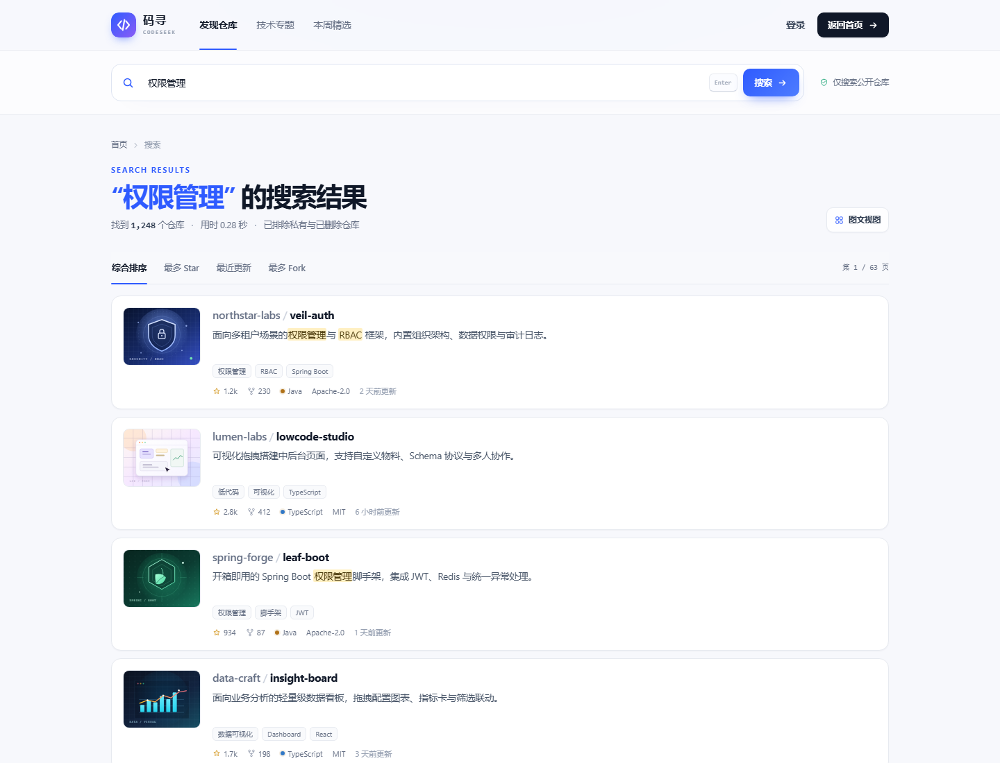
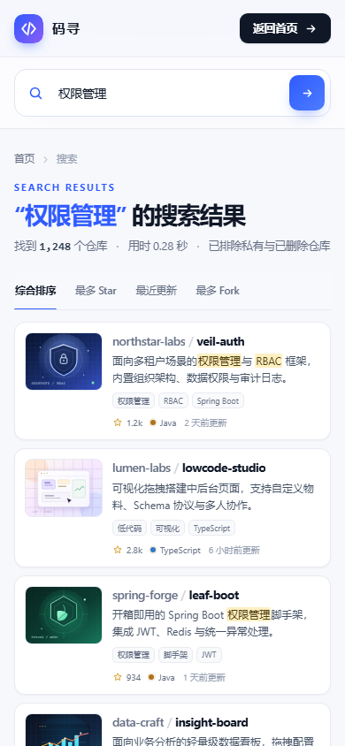

# 码寻 CodeSeek — 前端原型

基于 [PRD V1.0](../prd/代码仓库搜索引擎-PRD-v1.0.md) 制作的 HTML/CSS 静态原型，附带一小段原生 JS 处理首页导航高亮，用于评审首页、搜索结果图文卡片、分页和移动端适配。



## 预览方式

直接双击 `index.html` 即可浏览，或从当前目录启动一个静态文件服务器：

```bash
python -m http.server 8090
```

然后访问：

- 首页：`http://127.0.0.1:8090/index.html`
- 搜索结果：`http://127.0.0.1:8090/search.html`

无需安装依赖，无需构建。

## 页面与文件

```text
ui/
├── index.html              # 搜索首页：Hero、热门搜索、技术专题、本周精选
├── search.html             # 搜索结果页：图文卡片、排序条、分页、搜索提示
├── styles.css              # 全站样式、设计变量、响应式与动效
├── app.js                  # 首页导航滚动监听与当前栏目高亮
├── preview-desktop.png     # 桌面端预览
├── preview-mobile.png      # 移动端预览
├── README.md
└── assets/
    ├── favicon.svg
    ├── cover-security.svg  # veil-auth 封面
    ├── cover-lowcode.svg   # lowcode-studio 封面
    ├── cover-spring.svg    # leaf-boot 封面
    ├── cover-data.svg      # insight-board 封面
    ├── cover-miniapp.svg   # mini-flow 封面
    ├── cover-ai.svg        # tiny-llm-notes 封面
    └── cover-db.svg        # oxide-db 封面
```

## 与 PRD 的对应关系

| PRD 要求 | 原型实现 |
| --- | --- |
| 搜索结果图文样式 | 每张仓库卡片左侧为 4:3 封面，右侧为名称、简介、主题、语言、Star、Fork、许可证与更新时间 |
| 图片降级 | `moss-design` 卡片使用确定性渐变占位图，演示无封面/加载失败时的降级效果 |
| 关键词搜索 | 首页与结果页均有搜索框；结果页展示关键词、结果数、耗时，并对命中词做高亮 |
| 多仓库分页 | 结果页展示 8 个仓库示例、总数 1,248、1–63 页分页器、上一页/下一页、每页 10/20/50 条切换 |
| 结果状态 | 覆盖默认态、归档标识、图片占位、加载骨架样式（CSS 已定义，可在接入数据时启用） |
| 响应式 | 1120px 桌面内容区；900px 平板双列专题；390px 移动端单列卡片与简化分页 |
| 可访问性 | 语义化结构、跳过导航链接、图片 alt、键盘焦点环、分页 `aria-current`、按钮 `aria-label` |

## 设计说明

- **视觉方向**：以浅灰蓝为底，电光蓝作为品牌色，暖橙作为高亮色；整体偏开发者工具，但保留消费级产品的留白与节奏。
- **品牌**：原型暂用「码寻 CodeSeek」名称，便于展示；正式品牌名可替换。
- **图片**：全部封面为本地 SVG 插画，不依赖外网，方便离线评审。
- **数据**：页面中的仓库名称、Star 数、更新时间均为虚构演示数据，不代表真实项目。
- **交互边界**：本原型以 HTML/CSS 为主；`app.js` 只负责首页「发现仓库 / 技术专题 / 本周精选」的滚动高亮和点击切换，其余搜索、分页、排序和卡片点击仍是视觉锚点，接入后端后需替换为实际路由和请求。
- **断点**：`1020px`（专题双列）、`860px`（隐藏主导航）、`720px`（移动端卡片与简化分页）、`520px`（单列专题与紧凑卡片）。



## 评审建议

1. 优先确认卡片图片比例、信息层级和元数据取舍。
2. 确认移动端是否保留「每页条数」和「搜索小贴士」。
3. 确认结果页是否需要在首屏露出「图文视图」状态标识。
4. 确认品牌名、主色与示例仓库数据是否替换为正式素材。
